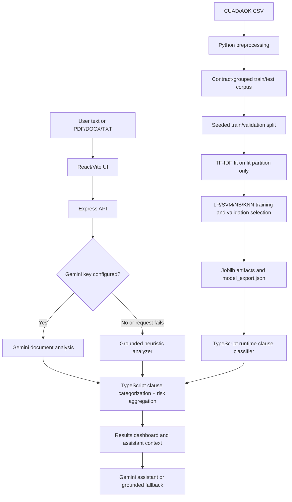

# LexiGuard — AI-Powered Legal Clause Classification and Contractual Risk Analysis

## Final Academic Project Report

**Prepared:** October 27, 2026  
**Project repository:** LexiGuard  
**Student/team, institution, department, course, academic year:** Not stated in the inspected project files; not inferred.

> **Scope note.** This report describes the checked-in implementation and saved experiment outputs. Clause-category classification is evaluated on labeled examples. The contract risk score is an application heuristic, not a validated legal-risk probability or legal opinion.

## Abstract

LexiGuard is a React/Vite web application with a Node.js/Express backend and a Python/scikit-learn training pipeline. It ingests contract text, supports clause categorization into 12 CUAD-derived categories, presents a risk-oriented review, and offers an assistant that can call Google Gemini when configured or use a deterministic project-grounded fallback. The training data is the project’s 510-row Atticus Open Contract Dataset (AOK/CUAD v1) CSV. After filtering empty target cells and removing duplicate category-text records, the cached corpus contains 4,673 clause examples.

The latest isolated Logistic Regression experiment compared six combinations of `C` and TF-IDF vocabulary size using the existing seeded, contract-grouped fit/validation split. Its best validation Macro F1 was **88.42%** (`C=1.0`, `max_features=3000`); the smallest train/validation Macro F1 gap was **0.72 percentage points** (`C=0.1`, `max_features=1500`). No test metrics were calculated in this six-configuration experiment. The saved production inference export remains an earlier Logistic Regression artifact; the experiment did not replace it. Risk scoring is computed separately with fixed severity points and escalation thresholds and has not been validated against expert risk labels.

In the follow-up five-fold contract-grouped comparison, `C=1.0` with 3,000 features had the highest mean validation Macro F1 (**86.95% ± 1.29 pp**) and was frozen before one final evaluation. It scored **94.06% accuracy** and **90.15% Macro F1** on the cached test partition. The historical benchmark had already used this same partition, so this is not a globally unseen test result; the new candidate remains undeployed.

## 1. Introduction and problem statement

Commercial contracts contain many provisions, legal cross-references, and jurisdiction-dependent language. Locating and comparing relevant clauses manually can be demanding. LexiGuard’s goal is to support preliminary review by surfacing clause topics and potential concerns in a readable interface.

**Objectives**

- Train and evaluate text classifiers for 12 clause categories.
- Keep clauses from the same source contract in one data partition.
- Fit learned TF-IDF vocabulary only on the fitting partition during validation.
- Provide document text extraction, clause analysis, a risk summary, and an assistant.
- Preserve the separation between a clause’s *topic* and an assessment’s *risk level*.

**Intended users and scope.** The application is an educational and preliminary-review aid for people inspecting English-language commercial contract text. It is not a lawyer, does not determine enforceability, and does not replace professional advice. The training corpus is SEC-filed commercial agreements; suitability for other contract types, jurisdictions, or languages is unverified.

## 2. Existing and proposed workflow

| Manual review context | LexiGuard support |
|---|---|
| A reviewer searches a long document for relevant provisions. | Upload or paste text; the interface returns extracted/identified clause information when available. |
| A reviewer must interpret unfamiliar wording. | The UI presents plain-language explanations and a context-aware assistant. |
| A reviewer must prioritize what to inspect. | The application produces rule/AI-derived risk labels and an aggregate heuristic score. |
| A reviewer verifies legal effect and context. | Still required: LexiGuard does not establish legal correctness or substitute for counsel. |

This comparison describes functions, not verified time savings, legal accuracy, or return on investment.

## 3. Requirements and technology

| Component | Verified project technology and role |
|---|---|
| Web UI | TypeScript, React, Vite; `src/` contains the upload, dashboard, charts, clause details, and assistant components. |
| Backend | Node.js/TypeScript with Express (`server.ts`); serves JSON APIs and the Vite development integration. |
| ML training | Python, NumPy, scikit-learn; TF-IDF, Logistic Regression, LinearSVC, MultinomialNB, KNN and metrics. |
| Model persistence | Joblib files for Python inference; JSON coefficient/vocabulary export for TypeScript inference. |
| Text/document handling | `csv` and standard Python preprocessing; Node libraries include `pdf-parse` and `mammoth` for PDF/DOCX extraction; browser-side DOCX extraction also uses Mammoth. |
| Assistant | `@google/genai` is used server-side when `GEMINI_API_KEY` is a non-placeholder value. |
| UI support | `lucide-react`, `motion`, `recharts`; Tailwind CSS Vite integration is configured. |
| Tests/build | `tsx` runs TypeScript tests/scripts; `tsc --noEmit` is the lint script; Vite provides the production build. |

`package.json` is the verified JavaScript dependency manifest. No `requirements.txt`, `pyproject.toml`, or Python lock file was found in the project root or `ml_pipeline/`; exact Python dependency versions are therefore not declared there. Training imports scikit-learn, NumPy, and joblib.

## 4. Dataset, schema, and target labels

### 4.1 Provenance and source schema

The source file `data/aok_dataset/master_clauses.csv` has **510 rows and 83 columns**. Project files identify it as the Atticus Open Contract Dataset / Contract Understanding Atticus Dataset (AOK/CUAD v1), based on SEC EDGAR commercial contracts. The project cites CC BY 4.0; consult the upstream dataset distribution and its license for the authoritative terms. The source schema consists of a `Filename`, document metadata and paired clause quote/answer fields. The preprocessing code selects only columns whose header exactly matches one of the 12 target names; answer/indicator fields and other metadata are not model input features.

For the supervised classifier:

- **Input feature source:** extracted clause quote text (a string).
- **Target:** the category name of the quote field from which that text was extracted.
- **Not model predictors:** contract filename/ID, `*-Answer` fields, other CSV metadata, and the untouched held-out test data during experiment fitting.

### 4.2 Target categories and cleaned counts

| Clause category | Training examples | Test examples | Total |
|---|---:|---:|---:|
| Cap On Liability | 507 | 120 | 627 |
| Governing Law | 352 | 89 | 441 |
| Termination For Convenience | 183 | 36 | 219 |
| Audit Rights | 522 | 90 | 612 |
| Non-Compete | 189 | 38 | 227 |
| Anti-Assignment | 489 | 101 | 590 |
| Insurance | 423 | 106 | 529 |
| License Grant | 586 | 118 | 704 |
| Renewal Term | 157 | 43 | 200 |
| Notice Period To Terminate Renewal | 96 | 22 | 118 |
| Ip Ownership Assignment | 247 | 46 | 293 |
| Liquidated Damages | 97 | 16 | 113 |
| **Total** | **3,848** | **825** | **4,673** |

The counts are imbalanced: the largest class has 704 examples and the smallest 113. Only the 12 target categories above are used; the CSV offers additional annotations that this classifier does not model.

### 4.3 Cleaning and document counts

Preprocessing checks **6,120 target cells** (510 contracts × 12 selected categories): **3,625** are empty and treated as absent clause annotations, not negative text examples. The code extracted annotated quotes, rejected short/empty values, and removed **77** duplicate category-plus-normalized-text records. This leaves 4,673 examples (3,848 in the preprocessor’s training group and 825 in its held-out test group).

The initial document assignment is deterministic by source row index: every fifth contract record goes to the test group (102 records), the remainder to train (408). Some records have no retained target clauses. Therefore the downstream sample corpus contains examples from **368** train-side contract IDs and **97** test-side IDs; this accounts for the 295 fit + 73 validation and 97 represented test IDs in the saved training results. Document counts should not be confused with the number of CSV rows or clauses.

## 5. Preprocessing and leakage prevention

`ml_pipeline/preprocess.py` performs the following:

1. Reads the CSV and checks the presence of all 12 target columns.
2. Processes the selected quote fields. Empty values such as `[]`, null-like strings, or whitespace are not retained.
3. Extracts quoted list entries where present; unescapes newline/quote escapes, collapses whitespace, and filters very short text.
4. Normalizes text to lowercase ASCII alphanumeric tokens with punctuation replaced by spaces and whitespace collapsed.
5. Deduplicates by MD5 of `category + normalized text`, so identical text under different labels is not treated as the same key.
6. Assigns whole source contracts to train or test deterministically; all clauses from one contract remain together.
7. Builds labels from the selected source category. Metadata also records inverse-frequency class weights; the classifier uses `class_weight="balanced"` for Logistic Regression.
8. Writes `data/preprocessed_dataset.json`.

The experiment then reconstructs contract groups among the train-side samples, sorts contract IDs, shuffles with Python `random.Random(42)`, and holds out the first `int(20% × contract_count)` IDs for validation. This matches the split code in `train_and_evaluate.py`: **295 fit / 73 validation contract IDs**, with no shared IDs. It does not read or score `test_samples`.

`normalize_text` is regex-based; it does **not** implement Unicode NFC canonicalization or explicit smart-quote/em-dash normalization, despite claims in older documentation. Scikit-learn lowercases input by default. `preprocess.py` also stores tokens for inspection, but the training/experiment vectorizer receives the original clause text.

## 6. TF-IDF features

The training and current experiment use `TfidfVectorizer` with:

| Parameter | Value | Effect |
|---|---:|---|
| `ngram_range` | `(1, 2)` | Uses individual tokens and adjacent two-token phrases. |
| `min_df` | `3` | Ignores terms occurring in fewer than three fit documents. |
| `max_features` | `3000` or `1500` in the experiment | Caps vocabulary size; 3,000 is the production/default training value. |
| `sublinear_tf` | `True` | Scales term counts as `1 + log(count)`. |
| `norm` | `l2` | Normalizes each nonzero feature vector to unit Euclidean norm. |
| `stop_words` | `TS_STOPWORDS` | Reuses the project’s custom English list aligned with the TypeScript tokenizer. |

For each vocabulary-size setting, the vectorizer is fitted only on the fit portion, then the frozen transform is applied to fit/validation data. The six-run experiment did not refit a vectorizer on validation data. The final deployed artifacts were created separately by the older training run.

## 7. Algorithms and training setup

The full training script compares four classifiers:

- **Logistic Regression:** regularized linear classifier. Balanced class weights compensate for class frequency differences. The full pipeline tunes `C` over `[0.01, 0.1, 1, 5, 10]`; the recent isolated experiment tests `C` values `[0.1, 0.5, 1.0]`. Smaller `C` means stronger regularization in scikit-learn.
- **Linear SVM (`LinearSVC`):** learns linear decision boundaries with margin-based loss; the full pipeline tunes the same `C` grid and uses balanced class weights.
- **Multinomial Naive Bayes:** estimates class probabilities with a conditional-independence assumption; the full pipeline tunes `alpha` in `[0.1, 0.5, 1, 2]`.
- **K-Nearest Neighbors:** predicts from nearby TF-IDF vectors using cosine distance and distance weighting; the full pipeline tunes `k` in `[3, 5, 7, 11]`.

Only Logistic Regression was varied in the six-configuration experiment. It used the existing run’s other settings: `max_iter=300`, `class_weight="balanced"`, `random_state=42`. Validation Macro F1 is the selection metric; Macro F1 averages the class-level F1 scores equally, so common categories do not dominate as much as they do in accuracy.

## 8. Latest Logistic Regression experiment

These are the **current experiment** results saved in `data/logistic_regression_experiments.json`, generated by `ml_pipeline/experiment_logistic_regression.py`. They use the 295/73 contract-level split described above. Gaps are training minus validation, in percentage points.

| C | max_features | Training accuracy | Validation accuracy | Training Macro F1 | Validation Macro F1 | Accuracy gap (pp) | Macro F1 gap (pp) |
|---:|---:|---:|---:|---:|---:|---:|---:|
| 1.0 | 3000 | 95.43% | 92.98% | 91.79% | **88.42%** | 2.45 | 3.37 |
| 0.5 | 3000 | 94.58% | 92.73% | 90.82% | 87.98% | 1.85 | 2.84 |
| 0.1 | 3000 | 92.56% | 92.35% | 88.39% | 87.50% | 0.21 | 0.89 |
| 1.0 | 1500 | 95.14% | 92.60% | 91.49% | 87.63% | 2.54 | 3.86 |
| 0.5 | 1500 | 94.22% | 92.35% | 90.39% | 87.10% | 1.88 | 3.29 |
| 0.1 | 1500 | 91.97% | 91.71% | 87.68% | 86.95% | 0.26 | 0.72 |

**Best validation Macro F1:** `C=1.0`, `max_features=3000`, **88.42%**. The highest validation score is in the requested 80–90% interval. **Smallest Macro F1 gap:** `C=0.1`, `max_features=1500`, **0.72 pp**, with 86.95% validation Macro F1. The stronger-regularization `C=0.1`, 3,000-feature setting gives 87.50% validation Macro F1 with a 0.89 pp gap.

### Overfitting and generalization

All six training accuracies (91.97–95.43%) and validation accuracies (91.71–92.98%) are above 90%; no tested configuration has both below 90%. Macro F1 gaps range from 0.72 to 3.86 pp, and accuracy gaps from 0.21 to 2.54 pp. Reducing `C` reduces the observed gaps in this split but also slightly lowers validation Macro F1. Reducing the vocabulary to 1,500 did not improve the best validation Macro F1, and its `C=1.0` setting has the largest Macro F1 gap. The best validation score and smallest gap are therefore different configurations.

These observations do not prove the classifier is overfit-free. Validation is one held-out split; its score can vary with contract composition, and the smallest gap alone does not establish better external generalization. The held-out test set was not used for any choice or metric in this six-setting experiment. Training and validation Macro precision, Macro recall, Macro F1, weighted precision/recall/F1, per-class support/precision/recall/F1, and 12×12 confusion matrices were calculated for all six configurations and are saved in `data/logistic_regression_experiments.json`. The detailed experiment report contains the aggregate comparison and selected-configuration class diagnostics.

### 8.1 Five-fold contract-grouped cross-validation

The same six configurations were evaluated with seeded `StratifiedGroupKFold` on all 3,848 preprocessor training clauses from 368 sample-bearing contracts. There are five folds, with 71–79 validation contracts and 769–770 validation clauses per fold. All clauses from a source contract remain together; every fold contains all 12 classes. Each fold fits a fresh vectorizer on its training portion only. The 825 held-out test clauses were not used for fold construction or selection.

| C | Features | Accuracy mean ± SD | Macro P mean ± SD | Macro R mean ± SD | Macro F1 mean ± SD | Weighted P mean ± SD | Weighted R mean ± SD | Weighted F1 mean ± SD | Macro F1 gap mean ± SD |
|---:|---:|---:|---:|---:|---:|---:|---:|---:|---:|
| 1.0 | 3000 | 92.02 ± 0.99% | 86.74 ± 1.30% | 87.53 ± 1.38% | **86.95 ± 1.29%** | 92.26 ± 1.00% | 92.02 ± 0.99% | 92.04 ± 0.98% | 5.07 ± 1.31 pp |
| 0.5 | 3000 | 91.66 ± 1.00% | 86.38 ± 1.44% | 87.43 ± 1.49% | 86.72 ± 1.45% | 91.99 ± 1.05% | 91.66 ± 1.00% | 91.71 ± 1.02% | 4.41 ± 1.55 pp |
| 0.1 | 3000 | 90.67 ± 1.20% | 85.67 ± 1.80% | 87.00 ± 1.70% | 85.85 ± 1.57% | 91.30 ± 1.27% | 90.67 ± 1.20% | 90.74 ± 1.19% | 2.75 ± 1.79 pp |
| 1.0 | 1500 | 91.68 ± 1.06% | 86.19 ± 1.32% | 87.09 ± 1.32% | 86.50 ± 1.32% | 91.94 ± 1.00% | 91.68 ± 1.06% | 91.72 ± 1.05% | 5.31 ± 1.33 pp |
| 0.5 | 1500 | 91.16 ± 1.04% | 85.54 ± 1.07% | 86.83 ± 1.21% | 85.94 ± 1.12% | 91.61 ± 1.00% | 91.16 ± 1.04% | 91.24 ± 1.04% | 4.66 ± 1.25 pp |
| 0.1 | 1500 | 90.15 ± 1.62% | 84.98 ± 2.08% | 86.40 ± 2.16% | 85.15 ± 1.91% | 90.85 ± 1.71% | 90.15 ± 1.62% | 90.23 ± 1.61% | 2.77 ± 2.28 pp |

Mean is the arithmetic mean across folds; SD is the sample standard deviation (`ddof=1`). The selected configuration is **C=1.0, max_features=3000**, by highest mean validation Macro F1. Stronger regularization reduces the mean train/validation gap but also reduces mean validation Macro F1. The lowest Macro F1 category in grouped validation is `Notice Period To Terminate Renewal` (support 96 across held-out folds; mean F1 51.07% ± 5.50 pp, mean recall 53.05% ± 10.17 pp), followed by `Renewal Term` (support 157; mean F1 66.33% ± 2.79 pp). Full per-class metrics and pooled out-of-fold confusion matrix are in [the grouped CV JSON](../data/logistic_regression_grouped_cv.json) and [report](../data/logistic_regression_grouped_cv_report.md).

### 8.2 Frozen-candidate final test evaluation

After grouped CV selected and froze C=1.0 with 3,000 features, that one candidate was fitted on all 3,848 train-group clauses and evaluated once on the preprocessor’s 97 test contracts / 825 test clauses. The vectorizer was fitted only on training clauses. No candidate selection used the final-test metrics. Aggregate test results:

| Metric | Final test |
|---|---:|
| Accuracy | 94.06% |
| Macro precision | 89.63% |
| Macro recall | 91.61% |
| Macro F1 | 90.15% |
| Weighted precision | 94.66% |
| Weighted recall | 94.06% |
| Weighted F1 | 94.18% |

The `Renewal Term` category has test F1 73.68% (support 43); `Notice Period To Terminate Renewal` has test F1 61.82% (support 22). The complete support/precision/recall/F1 table and numeric-index 12×12 confusion matrix are in [the final test report](../data/logistic_regression_final_test_report.md) and [JSON](../data/logistic_regression_final_test.json).

**Historical-split caveat:** the existing production benchmark had already reported scores on this same held-out test partition on October 26. The new CV selection did not use those test metrics, but this is not a globally unseen dataset anymore. The retrospective aggregate comparison is fair as a same-cache/same-category-order reference: historical C=5.0 LR reported 94.30% accuracy, 90.33% Macro F1, and 94.40% weighted F1. The new C=1.0 candidate is slightly lower on those three aggregate scores. Production artifacts remain unchanged, and the new candidate is not promoted.

## 9. Separate persisted production benchmark

The current saved runtime export (`data/model_artifacts/model_export.json`) identifies **Logistic Regression** and has 3,000 features. Its associated persisted benchmark (`data/traditional_ml_results.json`, timestamped October 26, 2026) records the previous full training run with `C=5.0`, validation Macro F1 88.93%, held-out test accuracy 94.30%, test Macro F1 90.33%, and test Weighted F1 94.40%. The export does not have an explicit `C` field; the parameter value comes from the matching saved benchmark metadata. No replacement is recommended based on this comparison.

## 10. System architecture



The selected model in the saved production JSON export is Logistic Regression. The export contains categories, vocabulary, IDF values, and linear coefficients/intercepts used by `src/ml/clauseClassifier.ts`. Runtime classification is in-process; the separate Python inference script/service is also present but is not required for the TypeScript app’s classifier.

## 11. Application workflow and APIs

1. A user pastes text or uploads a supported document. The UI limits files to 25 MB.
2. TXT/Markdown is read as text; DOCX uses Mammoth; PDF extraction is sent to `/api/extract-text` and parsed with `pdf-parse`.
3. Image-only/scanned PDFs with no selectable text return a warning. OCR is not implemented.
4. `/api/analyze` sends text to Gemini when a valid server API key is configured; if no client exists or the call fails, it returns the server’s deterministic grounded heuristic analysis. The Gemini response path calls the runtime clause classifier for extracted clause text; fallback analysis uses its own pattern-based rules.
5. Clause category/confidence, plain-language descriptions, risk labels, recommendations, and document summary are shown where returned by the analysis path.
6. Users may ask the assistant about current document context. With Gemini configured it attempts `gemini-flash-latest` and times out after eight seconds; otherwise or on failure it uses a deterministic knowledge-base fallback.

Key implemented routes include:

| Route | Purpose |
|---|---|
| `POST /api/extract-text` | Extract searchable PDF, DOCX, or plain-text content. |
| `POST /api/analyze` | Run document analysis; uses Gemini if configured and grounded heuristics otherwise. |
| `POST /api/ml/classify` | Classify one clause using the runtime export. |
| `GET /api/ml/evaluation` | Return the persisted full-training-run results JSON. |
| `POST /api/assistant/chat` | Contextual assistant with Gemini/fallback behavior. |
| `GET /api/dataset/status`, `/categories`, `/search`, `/evaluation`, `/explorer` | Dataset metadata and search/explorer data. |

`GEMINI_API_KEY` is optional. `.env.example` contains placeholders; no secret is included in this report. AI-powered results depend on a working provider key/network. The fallback is rule/pattern based and should not be interpreted as equivalent to a legal expert or an AI assessment.

## 12. Heuristic risk scoring

`src/server/riskScoringService.ts` aggregates clause risk labels/scores supplied by an analysis path. For a clause without a finite positive numeric score, the service uses **85** for Critical, **75** for High, **50** for Medium/Moderate, and **20** for Low; a provided finite positive score is capped at 100. Critical clauses are counted as both critical and high for escalation. The per-clause values are averaged, rounded, and clamped:

`overallScore = min(100, max(0, round(sum(clause_scores) / total_clauses)))`

An empty clause list has an implementation default score of 30. Overall tier rules are:

- **High Risk** if score ≥ 60, at least two high/critical clauses, or any critical clause.
- Otherwise **Medium Risk** if score ≥ 35 or at least two medium clauses.
- Otherwise **Low Risk**.

These are deterministic thresholds, not a probability of loss or a legally validated risk model. Risk labels can depend on Gemini output when available or heuristic fallback content; clause category and risk tier are distinct.

## 13. Assistant and runtime parity

The assistant receives messages and optional selected-clause/current-document context, including clause text summaries and scores. It builds a project-grounded system prompt and may call Google Gemini. If that path is unavailable or fails, it returns a deterministic response from the embedded knowledge base. It can explain scores, categories, preprocessing, model metrics, and limitations; generated content can still be incomplete or wrong and is not legal advice.

The TypeScript classifier manually tokenizes text, computes sparse sublinear TF-IDF using exported IDF values, scores the exported class coefficients, and applies softmax to margins for normalized confidence-like values. These are **uncalibrated relative scores**, not calibrated posterior probabilities. `test/ts-inference-crosscheck.ts` sends all 24 probe clauses through both Python Joblib inference and TypeScript inference. The current artifacts agree on 24/24 predicted labels and 24/24 confidence values within 0.02 percentage points. Strict expected-label agreement is 23/24; an evidence-backed acceptable-label check is 24/24. The unmatched synthetic Renewal Term probe combines a renewal duration with the notice deadline to opt out. Its model decision scores are higher for Notice Period To Terminate Renewal (5.77822) than Renewal Term (4.83615). Although that exact synthetic sentence is not in the cache, 82 distinct normalized training texts appear under both renewal-related labels. This reflects overlapping annotation/topic evidence, not a Python/TypeScript mismatch; the strict expected-label result remains visible in the report.

## 14. Tests and verification

The repository includes:

- `test/risk-scoring.test.ts`: direct tests of `calculateRiskScoreBreakdown`, including defaults, invalid and out-of-range scores, rounding boundaries, and escalation rules.
- `test/ml-models.test.ts`: checks cached dataset metadata/disjointness, saved benchmark metric shape, runtime sample classifications, and separation of category labels from risk labels.
- `test/ts-inference-crosscheck.ts`: compares Python and TypeScript output on 24 representative, ambiguous, and short probes; it verifies model metadata, labels, and confidence agreement. Its output is stored at `data/ts_parity_results.txt`.
- `test/assistant-fallback.test.ts`: verifies disabled, unavailable, and timed-out Gemini paths use grounded fallback behavior without live provider calls.
- `test/api-integration.test.ts`: starts an isolated no-key Express server and exercises text, DOCX, searchable/image-only/corrupt PDF, type/size/empty guards, classification, analysis, assistant fallback, and PDF download.

Commands and checks executed:

| Command/check | Outcome |
|---|---|
| `npm run ml:grouped-cv` | Exit 0; evaluated all six settings using five contract-grouped folds, saved fold results and selected C=1.0 / 3,000 features by validation Macro F1. |
| `npm run ml:evaluate-frozen` | Exit 0 once after the CV choice was frozen; saved metrics for the selected candidate on the cached test partition. The script refuses to overwrite the one-time output. |
| `npm test` | Exit 0; all five stages passed: risk scoring, ML/assistant, Python/TypeScript parity, assistant fallback, and isolated API integration. Parity: 24/24 predictions, 24/24 confidence comparisons, 23/24 strict expected labels, 24/24 evidence-backed acceptable labels. |
| `npm run lint` | Exit 0; `tsc --noEmit` completed without diagnostics. |
| `npm run build` | Exit 0; Vite transformed 2,504 modules. `index` is 610.10 kB and lazy-loaded `ResultsDashboard` is 508.18 kB; both exceed Vite’s 500 kB advisory threshold. |
| `python -m py_compile ml_pipeline\grouped_cv_logistic_regression.py ml_pipeline\evaluate_frozen_logistic_regression.py ml_pipeline\generate_pdf_report.py ml_pipeline\inference.py ml_pipeline\experiment_logistic_regression.py` | Exit 0; all listed Python files compile. |
| `npm run report:pdf` | Regenerated the three PDF destinations from this report and appended JSON-derived six-run validation, grouped CV, and frozen test diagnostics. |
| PDF verification | All three outputs have valid PDF headers/EOF markers and are byte-identical; extracted text includes grouped CV, final test aggregates, the class mapping, and ambiguity notes. |
| Browser check at `http://localhost:3000` | Main page loaded. A simulated `/api/analyze` 503 error was shown to the user as “Analysis Could Not Complete” with the API message. No HMR handshake error appeared in this fresh port-3000 session; the earlier warning was observed only on the stopped temporary port-3001 session and its cause was not established. |

No live Gemini API call or OCR was tested. The final candidate test metrics come from the existing test partition; the historical benchmark had already used that same partition. The browser check used an intercepted simulated error, not a live Gemini run.

## 15. Limitations and future work

**Supported limitations**

- Training data is a finite collection of 510 SEC-filed contracts; distribution shift to consumer, employment, residential, international, or non-English documents is untested.
- Only 12 of 41 annotation categories are used; class support is uneven.
- The six-setting experiment’s initial results use one contract-level holdout; grouped cross-validation adds stability evidence but remains within this finite corpus.
- The cached test split had already been reported in the historical benchmark and is not globally unseen; the frozen candidate’s final metrics are a same-split follow-up, not a new independent test set.
- Runtime confidence-like values are uncalibrated.
- The 24-probe strict expected-label count is 23/24, while the evidence-backed acceptable-label count is 24/24 because one synthetic renewal probe contains two overlapping clause topics. Probe agreement does not establish correctness for all contract text.
- Scanned PDFs require OCR, which is not included.
- Risk scores and heuristic analysis are not calibrated/validated with expert risk labels.
- Gemini functionality requires a configured key and network; any fallback can miss context.
- No institution/team metadata was present in the inspected project files.

**Future enhancements**

1. Review the grouped-CV-selected candidate and its class-level results before considering any production replacement; keep a genuinely new final test set untouched in future work.
2. Add legally relevant labeled contracts while monitoring domain and class balance.
3. Investigate minority-class boundaries, especially renewal vs. renewal-notice provisions, with expert review.
4. Calibrate confidence on a separate validation procedure and test calibration.
5. Collect expert risk annotations before evaluating risk-score accuracy.
6. Add OCR, multilingual evaluation, and human review/correction flows.
7. Expand Python/TypeScript parity coverage to additional edge cases, languages, and artifact versions.

## 16. Conclusion

LexiGuard combines contract text extraction, machine-learning clause categorization, heuristic risk aggregation, a React dashboard, and an optional Gemini assistant. The initial six-configuration validation experiment’s best Macro F1 is **88.42%** (`C=1.0`, 3,000 features); the smallest holdout Macro F1 gap is **0.72 pp** (`C=0.1`, 1,500 features). Five-fold grouped CV selected C=1.0 / 3,000 features with **86.95% ± 1.29 pp** validation Macro F1. Its one-time test score on the existing cached partition is **94.06% accuracy / 90.15% Macro F1**, slightly below the historical C=5.0 benchmark on the same split. Production artifacts remain unchanged. These results support review, not a guarantee of external generalization or legal accuracy.

## 17. References

1. Hendrycks, D., Burns, C., Chen, A., & Ball, S. (2021). *CUAD: An Expert-Annotated NLP Dataset for Legal Contract Review.* NeurIPS 2021. [arXiv:2103.06268](https://arxiv.org/abs/2103.06268).
2. The Atticus Project. [CUAD repository and dataset information](https://github.com/The-Atticus-Project/cuad). The project records the dataset license as CC BY 4.0; verify the terms in the distributed dataset before redistribution.
3. Pedregosa, F., et al. (2011). Scikit-learn: Machine Learning in Python. *Journal of Machine Learning Research, 12*, 2825–2830. [JMLR article](https://www.jmlr.org/papers/v12/pedregosa11a.html).
4. Scikit-learn documentation: [Text feature extraction](https://scikit-learn.org/stable/modules/feature_extraction.html#text-feature-extraction) and [LogisticRegression](https://scikit-learn.org/stable/modules/generated/sklearn.linear_model.LogisticRegression.html).
5. Official project documentation: [React](https://react.dev/), [Vite](https://vite.dev/), [Express](https://expressjs.com/), and [Google Gemini API](https://ai.google.dev/gemini-api/docs).

## Appendix A. Project structure and commands

```text
lexiguard/
├── data/
│   ├── aok_dataset/master_clauses.csv
│   ├── preprocessed_dataset.json
│   ├── traditional_ml_results.json
│   ├── logistic_regression_experiments.json
│   ├── logistic_regression_grouped_cv.json
│   ├── logistic_regression_final_test.json
│   └── model_artifacts/{best_model.joblib, vectorizer.joblib, model_export.json}
├── docs/
│   ├── LexiGuard_Final_Project_Report.md
│   ├── LexiGuard_Viva_Questions.md
│   └── LexiGuard_Final_Audit.md
├── ml_pipeline/
│   ├── preprocess.py
│   ├── train_and_evaluate.py
│   ├── experiment_logistic_regression.py
│   ├── grouped_cv_logistic_regression.py
│   ├── evaluate_frozen_logistic_regression.py
│   ├── inference.py
│   ├── audit_validation.py
│   └── generate_pdf_report.py
├── src/
│   ├── components/       # React UI
│   ├── ml/               # TypeScript runtime classifier
│   ├── server/           # dataset, assistant, risk services
│   └── utils/            # document extraction and analysis client
├── test/                 # ML, risk, and probe tests
├── server.ts
└── package.json
```

**Run the app:** `npm install`, then `npm run dev`, then open `http://localhost:3000`.  
**Experiments:** `python ml_pipeline\experiment_logistic_regression.py`, `npm run ml:grouped-cv`, then review the saved CV report before the one-time `npm run ml:evaluate-frozen` (the final evaluation refuses to overwrite an existing output). These use cached data and do not overwrite deployed artifacts.  
**Full older pipeline:** `python ml_pipeline\preprocess.py`, then `python ml_pipeline\train_and_evaluate.py`. The training script writes production artifacts and should not be run merely to reproduce the isolated experiment.  
**Tests/build:** `npm test`, `npm run lint`, `npm run build`.  
**Report PDF:** `npm run report:pdf` (requires the ReportLab package used by the existing project PDF workflow).  
**Environment:** `GEMINI_API_KEY` (optional; real Gemini requests), `PORT` (optional; default 3000), `APP_URL` (optional/configuration use). Never commit actual secrets.

**Source artifacts:** preprocessing fields and counts come from `ml_pipeline/preprocess.py` and `data/preprocessed_dataset.json`; the single-split experiment from `ml_pipeline/experiment_logistic_regression.py`; grouped CV and final test evaluation from `ml_pipeline/grouped_cv_logistic_regression.py`, `ml_pipeline/evaluate_frozen_logistic_regression.py`, and their JSON reports; runtime selection from `data/model_artifacts/model_export.json`; application behavior from `server.ts`, `src/ml/clauseClassifier.ts`, `src/server/riskScoringService.ts`, and `src/server/assistantService.ts`.
